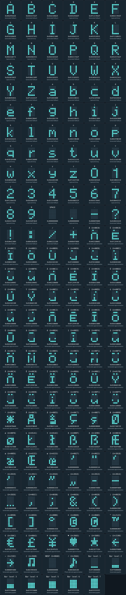

# Complete 5x7 display bitmap catalogue

Every character below includes its complete bitmap and 40-bit hexadecimal
word. No additional reference font is needed to use these patterns.
**Captured Sony** means the word was extracted from an original display
capture. **Generated fallback** means an application-designed glyph, not a
claimed original Sony shape. Red letters/digits and fixed indicators are
separate fields and must not use these text patterns.

## Encoding and full control

Rows run top to bottom; columns run left to right. `#` is lit and `.` is
unlit. With zero-based coordinates, `bit = row * 5 + column`:

```text
 0  1  2  3  4
 5  6  7  8  9
10 11 12 13 14
15 16 17 18 19
20 21 22 23 24
25 26 27 28 29
30 31 32 33 34
```

Set or clear each bit independently. Bits 35-39 are zero in these glyphs;
they are not established ON/OFF flags. Transmit all 40 bits, **bit 39 first**.
The output latch holds the previous pattern during normal shifting; STB
and grid CLEAR timing expose the completed glyph under the selected grid.
Continuous 26-slot scanning is still required.

Mapped text slots are message 14-22, frequency 6-10 and suffix 3-5.
Message positions left to right correspond to slots 22 down to 14.
Individual live pixel orientation remains to be validated.

Case matters. Missing captured characters use the generated shapes listed
here. Identical generated shapes, such as O and 0, are font-design choices.

## Visual character grid

Each cell shows the character, its exact 5x7 rendering, complete 40-bit HEX
word and source. Cyan pixels are lit; dark pixels are unlit. This chart uses
our current glyphs, not a reproduction of the reference website's font.
The music note is photo-derived; extended glyphs are generated approximations.



[Open the full-size character chart](media/display-bitmap-chart.svg).

## Character HEX index

| Character | 40-bit HEX | Source |
|-----------|------------|--------|
| A | `0x0463F8C62E` | Generated fallback |
| B | `0x03E317C62F` | Generated fallback |
| C | `0x03A210862E` | Generated fallback |
| D | `0x03E5294A4F` | Captured Sony |
| E | `0x07C217843F` | Generated fallback |
| F | `0x004217843F` | Captured Sony |
| G | `0x07A31E862E` | Generated fallback |
| H | `0x04631FC631` | Captured Sony |
| I | `0x038842108E` | Generated fallback |
| J | `0x019284211C` | Generated fallback |
| K | `0x0452519531` | Generated fallback |
| L | `0x07C2108421` | Generated fallback |
| M | `0x04631AD771` | Captured Sony |
| N | `0x04639ACE31` | Captured Sony |
| O | `0x03A318C62E` | Generated fallback |
| P | `0x004217C62F` | Generated fallback |
| Q | `0x059358C62E` | Generated fallback |
| R | `0x045257C62F` | Captured Sony |
| S | `0x03A307062E` | Captured Sony |
| T | `0x010842109F` | Generated fallback |
| U | `0x03A318C631` | Generated fallback |
| V | `0x011518C631` | Generated fallback |
| W | `0x02AB5AC631` | Generated fallback |
| X | `0x0462A22A31` | Generated fallback |
| Y | `0x0108454631` | Generated fallback |
| Z | `0x07C222221F` | Generated fallback |
| a | `0x07A3E83800` | Generated fallback |
| b | `0x03E319B421` | Generated fallback |
| c | `0x078210F800` | Captured Sony |
| d | `0x07A31CDA10` | Generated fallback |
| e | `0x0783F8B800` | Captured Sony |
| f | `0x0084238A4C` | Generated fallback |
| g | `0x03A1E8C7C0` | Generated fallback |
| h | `0x046319B421` | Generated fallback |
| i | `0x0388421804` | Generated fallback |
| j | `0x0192843008` | Generated fallback |
| k | `0x024A32A421` | Generated fallback |
| l | `0x0388421086` | Generated fallback |
| m | `0x04635AAC00` | Generated fallback |
| n | `0x046319B400` | Captured Sony |
| o | `0x03A318B800` | Captured Sony |
| p | `0x0042F8BC00` | Generated fallback |
| q | `0x043D18F800` | Captured Sony |
| r | `0x0084236800` | Captured Sony |
| s | `0x03E0E0B800` | Generated fallback |
| t | `0x0324211C42` | Generated fallback |
| u | `0x05B318C400` | Captured Sony |
| v | `0x011518C400` | Generated fallback |
| w | `0x02AB58C400` | Generated fallback |
| x | `0x0454454400` | Generated fallback |
| y | `0x03A1E8C400` | Captured Sony |
| z | `0x07C4447C00` | Captured Sony |
| 0 | `0x03A318C62E` | Captured Sony |
| 1 | `0x02108421C8` | Captured Sony |
| 2 | `0x07C226422E` | Captured Sony |
| 3 | `0x03A306422E` | Captured Sony |
| 4 | `0x0211F4A988` | Generated fallback |
| 5 | `0x03A3083C3F` | Generated fallback |
| 6 | `0x03A317844C` | Generated fallback |
| 7 | `0x010844221F` | Captured Sony |
| 8 | `0x03A317462E` | Captured Sony |
| 9 | `0x01910F462E` | Generated fallback |
| SPACE | `0x0000000000` | Captured Sony |
| . | `0x0080000000` | Captured Sony |
| - | `0x00000F8000` | Generated fallback |
| ? | `0x010044422E` | Generated fallback |
| ! | `0x0100421084` | Generated fallback |
| : | `0x000C6018C0` | Generated fallback |
| / | `0x0002222200` | Generated fallback |
| + | `0x00084F9080` | Generated fallback |

## Uppercase A-Z

### A

**HEX:** `0x0463F8C62E` — Generated fallback

```text
.###.
#...#
#...#
#...#
#####
#...#
#...#
```

### B

**HEX:** `0x03E317C62F` — Generated fallback

```text
####.
#...#
#...#
####.
#...#
#...#
####.
```

### C

**HEX:** `0x03A210862E` — Generated fallback

```text
.###.
#...#
#....
#....
#....
#...#
.###.
```

### D

**HEX:** `0x03E5294A4F` — Captured Sony

```text
####.
.#..#
.#..#
.#..#
.#..#
.#..#
####.
```

### E

**HEX:** `0x07C217843F` — Generated fallback

```text
#####
#....
#....
####.
#....
#....
#####
```

### F

**HEX:** `0x004217843F` — Captured Sony

```text
#####
#....
#....
####.
#....
#....
#....
```

### G

**HEX:** `0x07A31E862E` — Generated fallback

```text
.###.
#...#
#....
#.###
#...#
#...#
.####
```

### H

**HEX:** `0x04631FC631` — Captured Sony

```text
#...#
#...#
#...#
#####
#...#
#...#
#...#
```

### I

**HEX:** `0x038842108E` — Generated fallback

```text
.###.
..#..
..#..
..#..
..#..
..#..
.###.
```

### J

**HEX:** `0x019284211C` — Generated fallback

```text
..###
...#.
...#.
...#.
...#.
#..#.
.##..
```

### K

**HEX:** `0x0452519531` — Generated fallback

```text
#...#
#..#.
#.#..
##...
#.#..
#..#.
#...#
```

### L

**HEX:** `0x07C2108421` — Generated fallback

```text
#....
#....
#....
#....
#....
#....
#####
```

### M

**HEX:** `0x04631AD771` — Captured Sony

```text
#...#
##.##
#.#.#
#.#.#
#...#
#...#
#...#
```

### N

**HEX:** `0x04639ACE31` — Captured Sony

```text
#...#
#...#
##..#
#.#.#
#..##
#...#
#...#
```

### O

**HEX:** `0x03A318C62E` — Generated fallback

```text
.###.
#...#
#...#
#...#
#...#
#...#
.###.
```

### P

**HEX:** `0x004217C62F` — Generated fallback

```text
####.
#...#
#...#
####.
#....
#....
#....
```

### Q

**HEX:** `0x059358C62E` — Generated fallback

```text
.###.
#...#
#...#
#...#
#.#.#
#..#.
.##.#
```

### R

**HEX:** `0x045257C62F` — Captured Sony

```text
####.
#...#
#...#
####.
#.#..
#..#.
#...#
```

### S

**HEX:** `0x03A307062E` — Captured Sony

```text
.###.
#...#
#....
.###.
....#
#...#
.###.
```

### T

**HEX:** `0x010842109F` — Generated fallback

```text
#####
..#..
..#..
..#..
..#..
..#..
..#..
```

### U

**HEX:** `0x03A318C631` — Generated fallback

```text
#...#
#...#
#...#
#...#
#...#
#...#
.###.
```

### V

**HEX:** `0x011518C631` — Generated fallback

```text
#...#
#...#
#...#
#...#
#...#
.#.#.
..#..
```

### W

**HEX:** `0x02AB5AC631` — Generated fallback

```text
#...#
#...#
#...#
#.#.#
#.#.#
#.#.#
.#.#.
```

### X

**HEX:** `0x0462A22A31` — Generated fallback

```text
#...#
#...#
.#.#.
..#..
.#.#.
#...#
#...#
```

### Y

**HEX:** `0x0108454631` — Generated fallback

```text
#...#
#...#
#...#
.#.#.
..#..
..#..
..#..
```

### Z

**HEX:** `0x07C222221F` — Generated fallback

```text
#####
....#
...#.
..#..
.#...
#....
#####
```

## Lowercase a-z

### a

**HEX:** `0x07A3E83800` — Generated fallback

```text
.....
.....
.###.
....#
.####
#...#
.####
```

### b

**HEX:** `0x03E319B421` — Generated fallback

```text
#....
#....
#.##.
##..#
#...#
#...#
####.
```

### c

**HEX:** `0x078210F800` — Captured Sony

```text
.....
.....
.####
#....
#....
#....
.####
```

### d

**HEX:** `0x07A31CDA10` — Generated fallback

```text
....#
....#
.##.#
#..##
#...#
#...#
.####
```

### e

**HEX:** `0x0783F8B800` — Captured Sony

```text
.....
.....
.###.
#...#
#####
#....
.####
```

### f

**HEX:** `0x0084238A4C` — Generated fallback

```text
..##.
.#..#
.#...
###..
.#...
.#...
.#...
```

### g

**HEX:** `0x03A1E8C7C0` — Generated fallback

```text
.....
.####
#...#
#...#
.####
....#
.###.
```

### h

**HEX:** `0x046319B421` — Generated fallback

```text
#....
#....
#.##.
##..#
#...#
#...#
#...#
```

### i

**HEX:** `0x0388421804` — Generated fallback

```text
..#..
.....
.##..
..#..
..#..
..#..
.###.
```

### j

**HEX:** `0x0192843008` — Generated fallback

```text
...#.
.....
..##.
...#.
...#.
#..#.
.##..
```

### k

**HEX:** `0x024A32A421` — Generated fallback

```text
#....
#....
#..#.
#.#..
##...
#.#..
#..#.
```

### l

**HEX:** `0x0388421086` — Generated fallback

```text
.##..
..#..
..#..
..#..
..#..
..#..
.###.
```

### m

**HEX:** `0x04635AAC00` — Generated fallback

```text
.....
.....
##.#.
#.#.#
#.#.#
#...#
#...#
```

### n

**HEX:** `0x046319B400` — Captured Sony

```text
.....
.....
#.##.
##..#
#...#
#...#
#...#
```

### o

**HEX:** `0x03A318B800` — Captured Sony

```text
.....
.....
.###.
#...#
#...#
#...#
.###.
```

### p

**HEX:** `0x0042F8BC00` — Generated fallback

```text
.....
.....
####.
#...#
####.
#....
#....
```

### q

**HEX:** `0x043D18F800` — Captured Sony

```text
.....
.....
.####
#...#
#...#
.####
....#
```

### r

**HEX:** `0x0084236800` — Captured Sony

```text
.....
.....
.#.##
.##..
.#...
.#...
.#...
```

### s

**HEX:** `0x03E0E0B800` — Generated fallback

```text
.....
.....
.###.
#....
.###.
....#
####.
```

### t

**HEX:** `0x0324211C42` — Generated fallback

```text
.#...
.#...
###..
.#...
.#...
.#..#
..##.
```

### u

**HEX:** `0x05B318C400` — Captured Sony

```text
.....
.....
#...#
#...#
#...#
#..##
.##.#
```

### v

**HEX:** `0x011518C400` — Generated fallback

```text
.....
.....
#...#
#...#
#...#
.#.#.
..#..
```

### w

**HEX:** `0x02AB58C400` — Generated fallback

```text
.....
.....
#...#
#...#
#.#.#
#.#.#
.#.#.
```

### x

**HEX:** `0x0454454400` — Generated fallback

```text
.....
.....
#...#
.#.#.
..#..
.#.#.
#...#
```

### y

**HEX:** `0x03A1E8C400` — Captured Sony

```text
.....
.....
#...#
#...#
.####
....#
.###.
```

### z

**HEX:** `0x07C4447C00` — Captured Sony

```text
.....
.....
#####
...#.
..#..
.#...
#####
```

## Digits 0-9

### 0

**HEX:** `0x03A318C62E` — Captured Sony

```text
.###.
#...#
#...#
#...#
#...#
#...#
.###.
```

### 1

**HEX:** `0x02108421C8` — Captured Sony

```text
...#.
.###.
...#.
...#.
...#.
...#.
...#.
```

### 2

**HEX:** `0x07C226422E` — Captured Sony

```text
.###.
#...#
....#
..##.
.#...
#....
#####
```

### 3

**HEX:** `0x03A306422E` — Captured Sony

```text
.###.
#...#
....#
..##.
....#
#...#
.###.
```

### 4

**HEX:** `0x0211F4A988` — Generated fallback

```text
...#.
..##.
.#.#.
#..#.
#####
...#.
...#.
```

### 5

**HEX:** `0x03A3083C3F` — Generated fallback

```text
#####
#....
####.
....#
....#
#...#
.###.
```

### 6

**HEX:** `0x03A317844C` — Generated fallback

```text
..##.
.#...
#....
####.
#...#
#...#
.###.
```

### 7

**HEX:** `0x010844221F` — Captured Sony

```text
#####
....#
...#.
...#.
..#..
..#..
..#..
```

### 8

**HEX:** `0x03A317462E` — Captured Sony

```text
.###.
#...#
#...#
.###.
#...#
#...#
.###.
```

### 9

**HEX:** `0x01910F462E` — Generated fallback

```text
.###.
#...#
#...#
.####
....#
...#.
.##..
```

## Space and punctuation

### SPACE

**HEX:** `0x0000000000` — Captured Sony

```text
.....
.....
.....
.....
.....
.....
.....
```

### .

**HEX:** `0x0080000000` — Captured Sony

```text
.....
.....
.....
.....
.....
.....
.#...
```

### -

**HEX:** `0x00000F8000` — Generated fallback

```text
.....
.....
.....
#####
.....
.....
.....
```

### ?

**HEX:** `0x010044422E` — Generated fallback

```text
.###.
#...#
....#
...#.
..#..
.....
..#..
```

### !

**HEX:** `0x0100421084` — Generated fallback

```text
..#..
..#..
..#..
..#..
..#..
.....
..#..
```

### :

**HEX:** `0x000C6018C0` — Generated fallback

```text
.....
.##..
.##..
.....
.##..
.##..
.....
```

### /

**HEX:** `0x0002222200` — Generated fallback

```text
.....
....#
...#.
..#..
.#...
#....
.....
```

### +

**HEX:** `0x00084F9080` — Generated fallback

```text
.....
..#..
..#..
#####
..#..
..#..
.....
```

## Extended Latin, punctuation and symbols

These are application-designed 5x7 approximations, not captured Sony
glyphs. Accents use compact letter bodies to fit the seven-row grid;
fine details and some distinctions are necessarily lost. Hardware appearance
has not yet been validated. Each record below is supported by text lookup.

| Character | Unicode | Name | 40-bit HEX | Provenance |
|-----------|---------|------|------------|------------|
| À | U+00C0 | LATIN CAPITAL LETTER A WITH GRAVE | `0x046318B802` | Generated approximation |
| È | U+00C8 | LATIN CAPITAL LETTER E WITH GRAVE | `0x07C2F0FC02` | Generated approximation |
| Ì | U+00CC | LATIN CAPITAL LETTER I WITH GRAVE | `0x0388423802` | Generated approximation |
| Ò | U+00D2 | LATIN CAPITAL LETTER O WITH GRAVE | `0x03A318B802` | Generated approximation |
| Ù | U+00D9 | LATIN CAPITAL LETTER U WITH GRAVE | `0x03A318C402` | Generated approximation |
| à | U+00E0 | LATIN SMALL LETTER A WITH GRAVE | `0x07A3000002` | Generated approximation |
| è | U+00E8 | LATIN SMALL LETTER E WITH GRAVE | `0x0783100002` | Generated approximation |
| ì | U+00EC | LATIN SMALL LETTER I WITH GRAVE | `0x0388401002` | Generated approximation |
| ò | U+00F2 | LATIN SMALL LETTER O WITH GRAVE | `0x03A3100002` | Generated approximation |
| ù | U+00F9 | LATIN SMALL LETTER U WITH GRAVE | `0x05B3100002` | Generated approximation |
| Á | U+00C1 | LATIN CAPITAL LETTER A WITH ACUTE | `0x046318B808` | Generated approximation |
| É | U+00C9 | LATIN CAPITAL LETTER E WITH ACUTE | `0x07C2F0FC08` | Generated approximation |
| Í | U+00CD | LATIN CAPITAL LETTER I WITH ACUTE | `0x0388423808` | Generated approximation |
| Ó | U+00D3 | LATIN CAPITAL LETTER O WITH ACUTE | `0x03A318B808` | Generated approximation |
| Ú | U+00DA | LATIN CAPITAL LETTER U WITH ACUTE | `0x03A318C408` | Generated approximation |
| Ý | U+00DD | LATIN CAPITAL LETTER Y WITH ACUTE | `0x0108A8C408` | Generated approximation |
| á | U+00E1 | LATIN SMALL LETTER A WITH ACUTE | `0x07A3000008` | Generated approximation |
| é | U+00E9 | LATIN SMALL LETTER E WITH ACUTE | `0x0783100008` | Generated approximation |
| í | U+00ED | LATIN SMALL LETTER I WITH ACUTE | `0x0388401008` | Generated approximation |
| ó | U+00F3 | LATIN SMALL LETTER O WITH ACUTE | `0x03A3100008` | Generated approximation |
| ú | U+00FA | LATIN SMALL LETTER U WITH ACUTE | `0x05B3100008` | Generated approximation |
| ý | U+00FD | LATIN SMALL LETTER Y WITH ACUTE | `0x03A1100008` | Generated approximation |
| Â | U+00C2 | LATIN CAPITAL LETTER A WITH CIRCUMFLEX | `0x046318B80E` | Generated approximation |
| Ê | U+00CA | LATIN CAPITAL LETTER E WITH CIRCUMFLEX | `0x07C2F0FC0E` | Generated approximation |
| Î | U+00CE | LATIN CAPITAL LETTER I WITH CIRCUMFLEX | `0x038842380E` | Generated approximation |
| Ô | U+00D4 | LATIN CAPITAL LETTER O WITH CIRCUMFLEX | `0x03A318B80E` | Generated approximation |
| Û | U+00DB | LATIN CAPITAL LETTER U WITH CIRCUMFLEX | `0x03A318C40E` | Generated approximation |
| â | U+00E2 | LATIN SMALL LETTER A WITH CIRCUMFLEX | `0x07A300000E` | Generated approximation |
| ê | U+00EA | LATIN SMALL LETTER E WITH CIRCUMFLEX | `0x078310000E` | Generated approximation |
| î | U+00EE | LATIN SMALL LETTER I WITH CIRCUMFLEX | `0x038840100E` | Generated approximation |
| ô | U+00F4 | LATIN SMALL LETTER O WITH CIRCUMFLEX | `0x03A310000E` | Generated approximation |
| û | U+00FB | LATIN SMALL LETTER U WITH CIRCUMFLEX | `0x05B310000E` | Generated approximation |
| Ã | U+00C3 | LATIN CAPITAL LETTER A WITH TILDE | `0x046318B813` | Generated approximation |
| Ñ | U+00D1 | LATIN CAPITAL LETTER N WITH TILDE | `0x046358C413` | Generated approximation |
| Õ | U+00D5 | LATIN CAPITAL LETTER O WITH TILDE | `0x03A318B813` | Generated approximation |
| ã | U+00E3 | LATIN SMALL LETTER A WITH TILDE | `0x07A3000013` | Generated approximation |
| ñ | U+00F1 | LATIN SMALL LETTER N WITH TILDE | `0x0463300013` | Generated approximation |
| õ | U+00F5 | LATIN SMALL LETTER O WITH TILDE | `0x03A3100013` | Generated approximation |
| Ä | U+00C4 | LATIN CAPITAL LETTER A WITH DIAERESIS | `0x046318B80A` | Generated approximation |
| Ë | U+00CB | LATIN CAPITAL LETTER E WITH DIAERESIS | `0x07C2F0FC0A` | Generated approximation |
| Ï | U+00CF | LATIN CAPITAL LETTER I WITH DIAERESIS | `0x038842380A` | Generated approximation |
| Ö | U+00D6 | LATIN CAPITAL LETTER O WITH DIAERESIS | `0x03A318B80A` | Generated approximation |
| Ü | U+00DC | LATIN CAPITAL LETTER U WITH DIAERESIS | `0x03A318C40A` | Generated approximation |
| Ÿ | U+0178 | LATIN CAPITAL LETTER Y WITH DIAERESIS | `0x0108A8C40A` | Generated approximation |
| ä | U+00E4 | LATIN SMALL LETTER A WITH DIAERESIS | `0x07A300000A` | Generated approximation |
| ë | U+00EB | LATIN SMALL LETTER E WITH DIAERESIS | `0x078310000A` | Generated approximation |
| ï | U+00EF | LATIN SMALL LETTER I WITH DIAERESIS | `0x038840100A` | Generated approximation |
| ö | U+00F6 | LATIN SMALL LETTER O WITH DIAERESIS | `0x03A310000A` | Generated approximation |
| ü | U+00FC | LATIN SMALL LETTER U WITH DIAERESIS | `0x05B310000A` | Generated approximation |
| ÿ | U+00FF | LATIN SMALL LETTER Y WITH DIAERESIS | `0x03A110000A` | Generated approximation |
| Å | U+00C5 | LATIN CAPITAL LETTER A WITH RING ABOVE | `0x0463F8B94E` | Generated approximation |
| å | U+00E5 | LATIN SMALL LETTER A WITH RING ABOVE | `0x07BD071144` | Generated approximation |
| Ç | U+00C7 | LATIN CAPITAL LETTER C WITH CEDILLA | `0x0089E0843E` | Generated approximation |
| ç | U+00E7 | LATIN SMALL LETTER C WITH CEDILLA | `0x0088E0B800` | Generated approximation |
| Ø | U+00D8 | LATIN CAPITAL LETTER O WITH STROKE | `0x03E73AD73E` | Generated approximation |
| ø | U+00F8 | LATIN SMALL LETTER O WITH STROKE | `0x03E75CF800` | Generated approximation |
| Ł | U+0141 | LATIN CAPITAL LETTER L WITH STROKE | `0x07C2119421` | Generated approximation |
| ł | U+0142 | LATIN SMALL LETTER L WITH STROKE | `0x0388433086` | Generated approximation |
| ß | U+00DF | LATIN SMALL LETTER SHARP S | `0x036316A526` | Generated approximation |
| ẞ | U+1E9E | LATIN CAPITAL LETTER SHARP S | `0x036316A62F` | Generated approximation |
| Æ | U+00C6 | LATIN CAPITAL LETTER AE | `0x074A5F94BE` | Generated approximation |
| æ | U+00E6 | LATIN SMALL LETTER AE | `0x078BEA2C00` | Generated approximation |
| Π| U+0152 | LATIN CAPITAL LIGATURE OE | `0x078A5E94BE` | Generated approximation |
| œ | U+0153 | LATIN SMALL LIGATURE OE | `0x078BDAA800` | Generated approximation |
| ' | U+0027 | APOSTROPHE | `0x0000000884` | Generated approximation |
| " | U+0022 | QUOTATION MARK | `0x000000014A` | Generated approximation |
| ‘ | U+2018 | LEFT SINGLE QUOTATION MARK | `0x0000000844` | Generated approximation |
| ’ | U+2019 | RIGHT SINGLE QUOTATION MARK | `0x0000000442` | Generated approximation |
| “ | U+201C | LEFT DOUBLE QUOTATION MARK | `0x0000002954` | Generated approximation |
| ” | U+201D | RIGHT DOUBLE QUOTATION MARK | `0x000000154A` | Generated approximation |
| „ | U+201E | DOUBLE LOW-9 QUOTATION MARK | `0x0154A00000` | Generated approximation |
| – | U+2013 | EN DASH | `0x0000070000` | Generated approximation |
| — | U+2014 | EM DASH | `0x00000F8000` | Generated approximation |
| … | U+2026 | HORIZONTAL ELLIPSIS | `0x0540000000` | Generated approximation |
| , | U+002C | COMMA | `0x0088400000` | Generated approximation |
| ; | U+003B | SEMICOLON | `0x0088400080` | Generated approximation |
| & | U+0026 | AMPERSAND | `0x0593511526` | Generated approximation |
| ( | U+0028 | LEFT PARENTHESIS | `0x0208210888` | Generated approximation |
| ) | U+0029 | RIGHT PARENTHESIS | `0x0088842082` | Generated approximation |
| [ | U+005B | LEFT SQUARE BRACKET | `0x038421084E` | Generated approximation |
| ] | U+005D | RIGHT SQUARE BRACKET | `0x039084210E` | Generated approximation |
| ° | U+00B0 | DEGREE SIGN | `0x0000001926` | Generated approximation |
| © | U+00A9 | COPYRIGHT SIGN | `0x03A3DAF62E` | Generated approximation |
| ® | U+00AE | REGISTERED SIGN | `0x03A35EF62E` | Generated approximation |
| ™ | U+2122 | TRADE MARK SIGN | `0x0000002B57` | Generated approximation |
| € | U+20AC | EURO SIGN | `0x0704F13C5C` | Generated approximation |
| £ | U+00A3 | POUND SIGN | `0x07C4278A4C` | Generated approximation |
| ¥ | U+00A5 | YEN SIGN | `0x013E4F9151` | Generated approximation |
| ♥ | U+2665 | BLACK HEART SUIT | `0x0008EFFFEA` | Generated approximation |
| ★ | U+2605 | BLACK STAR | `0x0022E77C84` | Generated approximation |
| ← | U+2190 | LEFTWARDS ARROW | `0x00082F8880` | Generated approximation |
| → | U+2192 | RIGHTWARDS ARROW | `0x00088FA080` | Generated approximation |
| ♫ | U+266B | BEAMED EIGHTH NOTES | `0x0037B94A5E` | Generated approximation |
| NBSP | U+00A0 | NO-BREAK SPACE | `0x0000000000` | Generated space |

### À

**HEX:** `0x046318B802` — Generated approximation

**Unicode:** U+00C0 — LATIN CAPITAL LETTER A WITH GRAVE

```text
.#...
.....
.###.
#...#
#...#
#...#
#...#
```

### È

**HEX:** `0x07C2F0FC02` — Generated approximation

**Unicode:** U+00C8 — LATIN CAPITAL LETTER E WITH GRAVE

```text
.#...
.....
#####
#....
####.
#....
#####
```

### Ì

**HEX:** `0x0388423802` — Generated approximation

**Unicode:** U+00CC — LATIN CAPITAL LETTER I WITH GRAVE

```text
.#...
.....
.###.
..#..
..#..
..#..
.###.
```

### Ò

**HEX:** `0x03A318B802` — Generated approximation

**Unicode:** U+00D2 — LATIN CAPITAL LETTER O WITH GRAVE

```text
.#...
.....
.###.
#...#
#...#
#...#
.###.
```

### Ù

**HEX:** `0x03A318C402` — Generated approximation

**Unicode:** U+00D9 — LATIN CAPITAL LETTER U WITH GRAVE

```text
.#...
.....
#...#
#...#
#...#
#...#
.###.
```

### à

**HEX:** `0x07A3000002` — Generated approximation

**Unicode:** U+00E0 — LATIN SMALL LETTER A WITH GRAVE

```text
.#...
.....
.....
.....
....#
#...#
.####
```

### è

**HEX:** `0x0783100002` — Generated approximation

**Unicode:** U+00E8 — LATIN SMALL LETTER E WITH GRAVE

```text
.#...
.....
.....
.....
#...#
#....
.####
```

### ì

**HEX:** `0x0388401002` — Generated approximation

**Unicode:** U+00EC — LATIN SMALL LETTER I WITH GRAVE

```text
.#...
.....
..#..
.....
..#..
..#..
.###.
```

### ò

**HEX:** `0x03A3100002` — Generated approximation

**Unicode:** U+00F2 — LATIN SMALL LETTER O WITH GRAVE

```text
.#...
.....
.....
.....
#...#
#...#
.###.
```

### ù

**HEX:** `0x05B3100002` — Generated approximation

**Unicode:** U+00F9 — LATIN SMALL LETTER U WITH GRAVE

```text
.#...
.....
.....
.....
#...#
#..##
.##.#
```

### Á

**HEX:** `0x046318B808` — Generated approximation

**Unicode:** U+00C1 — LATIN CAPITAL LETTER A WITH ACUTE

```text
...#.
.....
.###.
#...#
#...#
#...#
#...#
```

### É

**HEX:** `0x07C2F0FC08` — Generated approximation

**Unicode:** U+00C9 — LATIN CAPITAL LETTER E WITH ACUTE

```text
...#.
.....
#####
#....
####.
#....
#####
```

### Í

**HEX:** `0x0388423808` — Generated approximation

**Unicode:** U+00CD — LATIN CAPITAL LETTER I WITH ACUTE

```text
...#.
.....
.###.
..#..
..#..
..#..
.###.
```

### Ó

**HEX:** `0x03A318B808` — Generated approximation

**Unicode:** U+00D3 — LATIN CAPITAL LETTER O WITH ACUTE

```text
...#.
.....
.###.
#...#
#...#
#...#
.###.
```

### Ú

**HEX:** `0x03A318C408` — Generated approximation

**Unicode:** U+00DA — LATIN CAPITAL LETTER U WITH ACUTE

```text
...#.
.....
#...#
#...#
#...#
#...#
.###.
```

### Ý

**HEX:** `0x0108A8C408` — Generated approximation

**Unicode:** U+00DD — LATIN CAPITAL LETTER Y WITH ACUTE

```text
...#.
.....
#...#
#...#
.#.#.
..#..
..#..
```

### á

**HEX:** `0x07A3000008` — Generated approximation

**Unicode:** U+00E1 — LATIN SMALL LETTER A WITH ACUTE

```text
...#.
.....
.....
.....
....#
#...#
.####
```

### é

**HEX:** `0x0783100008` — Generated approximation

**Unicode:** U+00E9 — LATIN SMALL LETTER E WITH ACUTE

```text
...#.
.....
.....
.....
#...#
#....
.####
```

### í

**HEX:** `0x0388401008` — Generated approximation

**Unicode:** U+00ED — LATIN SMALL LETTER I WITH ACUTE

```text
...#.
.....
..#..
.....
..#..
..#..
.###.
```

### ó

**HEX:** `0x03A3100008` — Generated approximation

**Unicode:** U+00F3 — LATIN SMALL LETTER O WITH ACUTE

```text
...#.
.....
.....
.....
#...#
#...#
.###.
```

### ú

**HEX:** `0x05B3100008` — Generated approximation

**Unicode:** U+00FA — LATIN SMALL LETTER U WITH ACUTE

```text
...#.
.....
.....
.....
#...#
#..##
.##.#
```

### ý

**HEX:** `0x03A1100008` — Generated approximation

**Unicode:** U+00FD — LATIN SMALL LETTER Y WITH ACUTE

```text
...#.
.....
.....
.....
#...#
....#
.###.
```

### Â

**HEX:** `0x046318B80E` — Generated approximation

**Unicode:** U+00C2 — LATIN CAPITAL LETTER A WITH CIRCUMFLEX

```text
.###.
.....
.###.
#...#
#...#
#...#
#...#
```

### Ê

**HEX:** `0x07C2F0FC0E` — Generated approximation

**Unicode:** U+00CA — LATIN CAPITAL LETTER E WITH CIRCUMFLEX

```text
.###.
.....
#####
#....
####.
#....
#####
```

### Î

**HEX:** `0x038842380E` — Generated approximation

**Unicode:** U+00CE — LATIN CAPITAL LETTER I WITH CIRCUMFLEX

```text
.###.
.....
.###.
..#..
..#..
..#..
.###.
```

### Ô

**HEX:** `0x03A318B80E` — Generated approximation

**Unicode:** U+00D4 — LATIN CAPITAL LETTER O WITH CIRCUMFLEX

```text
.###.
.....
.###.
#...#
#...#
#...#
.###.
```

### Û

**HEX:** `0x03A318C40E` — Generated approximation

**Unicode:** U+00DB — LATIN CAPITAL LETTER U WITH CIRCUMFLEX

```text
.###.
.....
#...#
#...#
#...#
#...#
.###.
```

### â

**HEX:** `0x07A300000E` — Generated approximation

**Unicode:** U+00E2 — LATIN SMALL LETTER A WITH CIRCUMFLEX

```text
.###.
.....
.....
.....
....#
#...#
.####
```

### ê

**HEX:** `0x078310000E` — Generated approximation

**Unicode:** U+00EA — LATIN SMALL LETTER E WITH CIRCUMFLEX

```text
.###.
.....
.....
.....
#...#
#....
.####
```

### î

**HEX:** `0x038840100E` — Generated approximation

**Unicode:** U+00EE — LATIN SMALL LETTER I WITH CIRCUMFLEX

```text
.###.
.....
..#..
.....
..#..
..#..
.###.
```

### ô

**HEX:** `0x03A310000E` — Generated approximation

**Unicode:** U+00F4 — LATIN SMALL LETTER O WITH CIRCUMFLEX

```text
.###.
.....
.....
.....
#...#
#...#
.###.
```

### û

**HEX:** `0x05B310000E` — Generated approximation

**Unicode:** U+00FB — LATIN SMALL LETTER U WITH CIRCUMFLEX

```text
.###.
.....
.....
.....
#...#
#..##
.##.#
```

### Ã

**HEX:** `0x046318B813` — Generated approximation

**Unicode:** U+00C3 — LATIN CAPITAL LETTER A WITH TILDE

```text
##..#
.....
.###.
#...#
#...#
#...#
#...#
```

### Ñ

**HEX:** `0x046358C413` — Generated approximation

**Unicode:** U+00D1 — LATIN CAPITAL LETTER N WITH TILDE

```text
##..#
.....
#...#
#...#
#.#.#
#...#
#...#
```

### Õ

**HEX:** `0x03A318B813` — Generated approximation

**Unicode:** U+00D5 — LATIN CAPITAL LETTER O WITH TILDE

```text
##..#
.....
.###.
#...#
#...#
#...#
.###.
```

### ã

**HEX:** `0x07A3000013` — Generated approximation

**Unicode:** U+00E3 — LATIN SMALL LETTER A WITH TILDE

```text
##..#
.....
.....
.....
....#
#...#
.####
```

### ñ

**HEX:** `0x0463300013` — Generated approximation

**Unicode:** U+00F1 — LATIN SMALL LETTER N WITH TILDE

```text
##..#
.....
.....
.....
##..#
#...#
#...#
```

### õ

**HEX:** `0x03A3100013` — Generated approximation

**Unicode:** U+00F5 — LATIN SMALL LETTER O WITH TILDE

```text
##..#
.....
.....
.....
#...#
#...#
.###.
```

### Ä

**HEX:** `0x046318B80A` — Generated approximation

**Unicode:** U+00C4 — LATIN CAPITAL LETTER A WITH DIAERESIS

```text
.#.#.
.....
.###.
#...#
#...#
#...#
#...#
```

### Ë

**HEX:** `0x07C2F0FC0A` — Generated approximation

**Unicode:** U+00CB — LATIN CAPITAL LETTER E WITH DIAERESIS

```text
.#.#.
.....
#####
#....
####.
#....
#####
```

### Ï

**HEX:** `0x038842380A` — Generated approximation

**Unicode:** U+00CF — LATIN CAPITAL LETTER I WITH DIAERESIS

```text
.#.#.
.....
.###.
..#..
..#..
..#..
.###.
```

### Ö

**HEX:** `0x03A318B80A` — Generated approximation

**Unicode:** U+00D6 — LATIN CAPITAL LETTER O WITH DIAERESIS

```text
.#.#.
.....
.###.
#...#
#...#
#...#
.###.
```

### Ü

**HEX:** `0x03A318C40A` — Generated approximation

**Unicode:** U+00DC — LATIN CAPITAL LETTER U WITH DIAERESIS

```text
.#.#.
.....
#...#
#...#
#...#
#...#
.###.
```

### Ÿ

**HEX:** `0x0108A8C40A` — Generated approximation

**Unicode:** U+0178 — LATIN CAPITAL LETTER Y WITH DIAERESIS

```text
.#.#.
.....
#...#
#...#
.#.#.
..#..
..#..
```

### ä

**HEX:** `0x07A300000A` — Generated approximation

**Unicode:** U+00E4 — LATIN SMALL LETTER A WITH DIAERESIS

```text
.#.#.
.....
.....
.....
....#
#...#
.####
```

### ë

**HEX:** `0x078310000A` — Generated approximation

**Unicode:** U+00EB — LATIN SMALL LETTER E WITH DIAERESIS

```text
.#.#.
.....
.....
.....
#...#
#....
.####
```

### ï

**HEX:** `0x038840100A` — Generated approximation

**Unicode:** U+00EF — LATIN SMALL LETTER I WITH DIAERESIS

```text
.#.#.
.....
..#..
.....
..#..
..#..
.###.
```

### ö

**HEX:** `0x03A310000A` — Generated approximation

**Unicode:** U+00F6 — LATIN SMALL LETTER O WITH DIAERESIS

```text
.#.#.
.....
.....
.....
#...#
#...#
.###.
```

### ü

**HEX:** `0x05B310000A` — Generated approximation

**Unicode:** U+00FC — LATIN SMALL LETTER U WITH DIAERESIS

```text
.#.#.
.....
.....
.....
#...#
#..##
.##.#
```

### ÿ

**HEX:** `0x03A110000A` — Generated approximation

**Unicode:** U+00FF — LATIN SMALL LETTER Y WITH DIAERESIS

```text
.#.#.
.....
.....
.....
#...#
....#
.###.
```

### Å

**HEX:** `0x0463F8B94E` — Generated approximation

**Unicode:** U+00C5 — LATIN CAPITAL LETTER A WITH RING ABOVE

```text
.###.
.#.#.
.###.
#...#
#####
#...#
#...#
```

### å

**HEX:** `0x07BD071144` — Generated approximation

**Unicode:** U+00E5 — LATIN SMALL LETTER A WITH RING ABOVE

```text
..#..
.#.#.
..#..
.###.
....#
.####
.####
```

### Ç

**HEX:** `0x0089E0843E` — Generated approximation

**Unicode:** U+00C7 — LATIN CAPITAL LETTER C WITH CEDILLA

```text
.####
#....
#....
#....
.####
..#..
.#...
```

### ç

**HEX:** `0x0088E0B800` — Generated approximation

**Unicode:** U+00E7 — LATIN SMALL LETTER C WITH CEDILLA

```text
.....
.....
.###.
#....
.###.
..#..
.#...
```

### Ø

**HEX:** `0x03E73AD73E` — Generated approximation

**Unicode:** U+00D8 — LATIN CAPITAL LETTER O WITH STROKE

```text
.####
#..##
#.#.#
#.#.#
##..#
##..#
####.
```

### ø

**HEX:** `0x03E75CF800` — Generated approximation

**Unicode:** U+00F8 — LATIN SMALL LETTER O WITH STROKE

```text
.....
.....
.####
#..##
#.#.#
##..#
####.
```

### Ł

**HEX:** `0x07C2119421` — Generated approximation

**Unicode:** U+0141 — LATIN CAPITAL LETTER L WITH STROKE

```text
#....
#....
#.#..
##...
#....
#....
#####
```

### ł

**HEX:** `0x0388433086` — Generated approximation

**Unicode:** U+0142 — LATIN SMALL LETTER L WITH STROKE

```text
.##..
..#..
..##.
.##..
..#..
..#..
.###.
```

### ß

**HEX:** `0x036316A526` — Generated approximation

**Unicode:** U+00DF — LATIN SMALL LETTER SHARP S

```text
.##..
#..#.
#..#.
#.##.
#...#
#...#
#.##.
```

### ẞ

**HEX:** `0x036316A62F` — Generated approximation

**Unicode:** U+1E9E — LATIN CAPITAL LETTER SHARP S

```text
####.
#...#
#..#.
#.##.
#...#
#...#
#.##.
```

### Æ

**HEX:** `0x074A5F94BE` — Generated approximation

**Unicode:** U+00C6 — LATIN CAPITAL LETTER AE

```text
.####
#.#..
#.#..
#####
#.#..
#.#..
#.###
```

### æ

**HEX:** `0x078BEA2C00` — Generated approximation

**Unicode:** U+00E6 — LATIN SMALL LETTER AE

```text
.....
.....
##.#.
..#.#
.####
#.#..
.####
```

### Œ

**HEX:** `0x078A5E94BE` — Generated approximation

**Unicode:** U+0152 — LATIN CAPITAL LIGATURE OE

```text
.####
#.#..
#.#..
#.###
#.#..
#.#..
.####
```

### œ

**HEX:** `0x078BDAA800` — Generated approximation

**Unicode:** U+0153 — LATIN SMALL LIGATURE OE

```text
.....
.....
.#.#.
#.#.#
#.###
#.#..
.####
```

### '

**HEX:** `0x0000000884` — Generated approximation

**Unicode:** U+0027 — APOSTROPHE

```text
..#..
..#..
.#...
.....
.....
.....
.....
```

### "

**HEX:** `0x000000014A` — Generated approximation

**Unicode:** U+0022 — QUOTATION MARK

```text
.#.#.
.#.#.
.....
.....
.....
.....
.....
```

### ‘

**HEX:** `0x0000000844` — Generated approximation

**Unicode:** U+2018 — LEFT SINGLE QUOTATION MARK

```text
..#..
.#...
.#...
.....
.....
.....
.....
```

### ’

**HEX:** `0x0000000442` — Generated approximation

**Unicode:** U+2019 — RIGHT SINGLE QUOTATION MARK

```text
.#...
.#...
#....
.....
.....
.....
.....
```

### “

**HEX:** `0x0000002954` — Generated approximation

**Unicode:** U+201C — LEFT DOUBLE QUOTATION MARK

```text
..#.#
.#.#.
.#.#.
.....
.....
.....
.....
```

### ”

**HEX:** `0x000000154A` — Generated approximation

**Unicode:** U+201D — RIGHT DOUBLE QUOTATION MARK

```text
.#.#.
.#.#.
#.#..
.....
.....
.....
.....
```

### „

**HEX:** `0x0154A00000` — Generated approximation

**Unicode:** U+201E — DOUBLE LOW-9 QUOTATION MARK

```text
.....
.....
.....
.....
.#.#.
.#.#.
#.#..
```

### –

**HEX:** `0x0000070000` — Generated approximation

**Unicode:** U+2013 — EN DASH

```text
.....
.....
.....
.###.
.....
.....
.....
```

### —

**HEX:** `0x00000F8000` — Generated approximation

**Unicode:** U+2014 — EM DASH

```text
.....
.....
.....
#####
.....
.....
.....
```

### …

**HEX:** `0x0540000000` — Generated approximation

**Unicode:** U+2026 — HORIZONTAL ELLIPSIS

```text
.....
.....
.....
.....
.....
.....
#.#.#
```

### ,

**HEX:** `0x0088400000` — Generated approximation

**Unicode:** U+002C — COMMA

```text
.....
.....
.....
.....
..#..
..#..
.#...
```

### ;

**HEX:** `0x0088400080` — Generated approximation

**Unicode:** U+003B — SEMICOLON

```text
.....
..#..
.....
.....
..#..
..#..
.#...
```

### &

**HEX:** `0x0593511526` — Generated approximation

**Unicode:** U+0026 — AMPERSAND

```text
.##..
#..#.
#.#..
.#...
#.#.#
#..#.
.##.#
```

### (

**HEX:** `0x0208210888` — Generated approximation

**Unicode:** U+0028 — LEFT PARENTHESIS

```text
...#.
..#..
.#...
.#...
.#...
..#..
...#.
```

### )

**HEX:** `0x0088842082` — Generated approximation

**Unicode:** U+0029 — RIGHT PARENTHESIS

```text
.#...
..#..
...#.
...#.
...#.
..#..
.#...
```

### [

**HEX:** `0x038421084E` — Generated approximation

**Unicode:** U+005B — LEFT SQUARE BRACKET

```text
.###.
.#...
.#...
.#...
.#...
.#...
.###.
```

### ]

**HEX:** `0x039084210E` — Generated approximation

**Unicode:** U+005D — RIGHT SQUARE BRACKET

```text
.###.
...#.
...#.
...#.
...#.
...#.
.###.
```

### °

**HEX:** `0x0000001926` — Generated approximation

**Unicode:** U+00B0 — DEGREE SIGN

```text
.##..
#..#.
.##..
.....
.....
.....
.....
```

### ©

**HEX:** `0x03A3DAF62E` — Generated approximation

**Unicode:** U+00A9 — COPYRIGHT SIGN

```text
.###.
#...#
#.###
#.#.#
#.###
#...#
.###.
```

### ®

**HEX:** `0x03A35EF62E` — Generated approximation

**Unicode:** U+00AE — REGISTERED SIGN

```text
.###.
#...#
#.###
#.###
#.#.#
#...#
.###.
```

### ™

**HEX:** `0x0000002B57` — Generated approximation

**Unicode:** U+2122 — TRADE MARK SIGN

```text
###.#
.#.##
.#.#.
.....
.....
.....
.....
```

### €

**HEX:** `0x0704F13C5C` — Generated approximation

**Unicode:** U+20AC — EURO SIGN

```text
..###
.#...
####.
.#...
####.
.#...
..###
```

### £

**HEX:** `0x07C4278A4C` — Generated approximation

**Unicode:** U+00A3 — POUND SIGN

```text
..##.
.#..#
.#...
####.
.#...
.#...
#####
```

### ¥

**HEX:** `0x013E4F9151` — Generated approximation

**Unicode:** U+00A5 — YEN SIGN

```text
#...#
.#.#.
..#..
#####
..#..
#####
..#..
```

### ♥

**HEX:** `0x0008EFFFEA` — Generated approximation

**Unicode:** U+2665 — BLACK HEART SUIT

```text
.#.#.
#####
#####
#####
.###.
..#..
.....
```

### ★

**HEX:** `0x0022E77C84` — Generated approximation

**Unicode:** U+2605 — BLACK STAR

```text
..#..
..#..
#####
.###.
.###.
#...#
.....
```

### ←

**HEX:** `0x00082F8880` — Generated approximation

**Unicode:** U+2190 — LEFTWARDS ARROW

```text
.....
..#..
.#...
#####
.#...
..#..
.....
```

### →

**HEX:** `0x00088FA080` — Generated approximation

**Unicode:** U+2192 — RIGHTWARDS ARROW

```text
.....
..#..
...#.
#####
...#.
..#..
.....
```

### ♫

**HEX:** `0x0037B94A5E` — Generated approximation

**Unicode:** U+266B — BEAMED EIGHTH NOTES

```text
.####
.#..#
.#..#
.#..#
##.##
##.##
.....
```

### NBSP

**HEX:** `0x0000000000` — Generated space

**Unicode:** U+00A0 — NO-BREAK SPACE

```text
.....
.....
.....
.....
.....
.....
.....
```

## Music-note symbol

Photo-derived symbol: fourteen lit pixels counted from the close-up;
not extracted from a Sony bus capture. Text input uses U+266A.

### ♪

**HEX:** `0x00CE6A5184` — Photo-derived approximation

**Unicode:** U+266A — EIGHTH NOTE

```text
..#..
..##.
..#.#
..#.#
.##..
###..
##...
```

## Seven vertical bar characters

Each level fills five complete columns from the bottom upward.
Minimum level 1 always lights the bottom row. The same set works for LEFT
and RIGHT; physical channel allocation and audio analysis are separate.

### Bar level 1

**HEX:** `0x07C0000000` — Generated graphic

```text
.....
.....
.....
.....
.....
.....
#####
```

### Bar level 2

**HEX:** `0x07FE000000` — Generated graphic

```text
.....
.....
.....
.....
.....
#####
#####
```

### Bar level 3

**HEX:** `0x07FFF00000` — Generated graphic

```text
.....
.....
.....
.....
#####
#####
#####
```

### Bar level 4

**HEX:** `0x07FFFF8000` — Generated graphic

```text
.....
.....
.....
#####
#####
#####
#####
```

### Bar level 5

**HEX:** `0x07FFFFFC00` — Generated graphic

```text
.....
.....
#####
#####
#####
#####
#####
```

### Bar level 6

**HEX:** `0x07FFFFFFE0` — Generated graphic

```text
.....
#####
#####
#####
#####
#####
#####
```

### Bar level 7

**HEX:** `0x07FFFFFFFF` — Generated graphic

```text
#####
#####
#####
#####
#####
#####
#####
```

## Unicode lookup and unsupported characters

Text is normalized to NFC before lookup and split into grapheme clusters,
so composed/decomposed accents occupy the same single cell. Captured Sony
glyphs take precedence; extended glyphs use the records above.

For an unlisted Latin letter with decomposable accents, lookup removes the
combining marks and uses the base letter as a one-cell transliteration.
Unlisted letters, scripts, standalone marks and unsupported multi-code-point
symbols (including emoji ZWJ sequences) use one visible question mark per
grapheme, not a blank or one replacement per UTF-16 byte/code unit.
A trailing text/emoji presentation selector on a listed symbol uses its
same monochrome glyph. NBSP renders as a blank space.
This is a finite repertoire, not complete Unicode coverage.

## Reproduction and evidence

Generated from the current editor dictionaries with:

```sh
cd firmware
node scripts/document_display_font.js ../10-display-bitmap-catalogue.md
```

Captured glyph sources include Frequency, No DSR, MHz, 132.0, 118.0 and
1227. Memory OK was captured on the older parallel controller bus and
does not provide additional original 40-bit pixel words.

See the [driver specification](08-esp-display-driver-specification.md)
and [music-note reference](09-music-note-bitmap.md).
