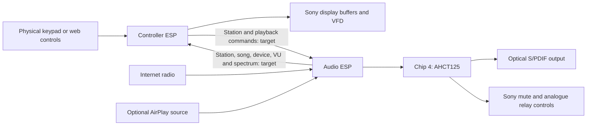

# Split-setup architecture

## Scope and current status

The target is two ESP32-S3 N16R8 development boards: a front-panel controller
and an audio receiver. The controller must also support portable interface
development without the Sony, keypad or audio ESP.

**Keep implemented behavior separate from the target architecture.**
Firmware 0.3.48 replaces the browser-only simulator with a hardware-backed
virtual front panel. The existing
controller still runs its original local radio decoder; audio playback has
not yet been migrated to the second ESP. The UART firmware currently provides
a diagnostic heartbeat and isolated GPIO mapping, not station commands or
audio telemetry. No complete inter-ESP exchange has yet been verified.

The **controller-only prototype**, built with `controller-s3`, removes
the local audio player and adds physical/virtual menu controls, Radio Browser
lookups, presets and a bounded version-2 station command on UART 43/44.
It was installed on the isolated controller for testing on 2026-11-20; it
reports version 0.3.49 with role `controller`. The previous app, SPIFFS and
OTA metadata were backed up before flashing. The audio-side receiver,
station acknowledgments and playback are not implemented; `AUDIO UNCONFIRMED`
means only that a command was queued locally, not delivered or played.

The prototype has a minimal screen/keypad web interface, not the existing
radio/settings setup pages. It reads legacy `pNN` presets but writes new
UUID-capable `sNN` records; those new records are invisible to old firmware.
Directory responses are bounded to 100 tags or stations, without pagination;
`~` indicates a potentially partial list. Stream codec and URL metadata are
directory hints, not proof that a stream plays. PROGRAM keys remain unmapped.
The controller caches up to six successful directory results in PSRAM:
countries and tags expire after 24 hours, station lists after 10 minutes.
The cache is cleared by reboot; failed requests are not cached.
Short DIRECT loads a separate in-memory country station index and opens a
blinking, case-insensitive prefix editor. FINE moves among available
characters; BLOCK advances six available characters; MEMORY locks a character.
LINK switches to a matching station list, and holding DIRECT queues the
highlighted station. Short MEMORY selects a station in category Top 10.
MHz/CLEAR goes back. Space is shown as a blinking underscore in the editor.
Only ASCII letters, digits and punctuation can be entered; stations with other
characters can still be browsed in the station list.

With no country filter, DIRECT indexes only the Netherlands (`NL`). To
search another country, apply its country filter first. The controller
downloads that country's entries in pages and shows progress as `INDEX NL 0`
or with the selected country code. The Dutch index is saved to SPIFFS and
restored on first use after reboot; other country indexes are kept only in
PSRAM. A missing or corrupt Dutch cache is rebuilt from the directory.
Selecting a match still resolves the stream URL online. Replacing the
SPIFFS image clears the Dutch cache. The controller build pins ESP-IDF
5.5.5, which includes Espressif's I80 DMA startup-stall fix (commit
`d3bdd18ddc`). The previous 5.5.0 build reset during indexing; one full run on
5.5.5 completed without a reset. A subsequent isolated 24 MS/s capture decoded
the default dim scan and found no invalid grid enables or clocks/strobes while
CLEAR was high. This is not a connected-Sony or analogue electrical validation.
On the isolated controller, virtual keys exercised country and genre lookups,
partial browsing, a category lookup and preset-store cancellation using actual
submitted display frames. A repeat country lookup took about 0.52 seconds versus
1.61 seconds for the initial query, including virtual key input delays.
Physical keys, complete directory coverage and end-to-end audio operation are
not yet validated; connected-Sony operation is not authorized by this test.
At the owner's request the controller now starts the normal dim display scan
automatically at boot, without running the full-fill startup animation. The
owner confirmed a verified power-aware hardware interlock independently keeps
the display buffers disabled while the Sony supply is invalid, including reset
and power-down. The firmware does not sense or control that interlock. Stopping
output remains possible, but the normal scan starts again on the next boot.

The first audio board repeatedly restarted, including with all header wires
removed. Device-specific ModemManager exclusions did not resolve it. Holding
BOOT during USB reconnection allowed verified ROM-loader access and flashing,
but changing UART backends and retaining panic output did not establish the
reset cause. Do not describe the board, PSRAM or UART wiring as proven faulty.
Its original full flash is backed up.

A replacement board was identified as ESP32-S3 revision 0.2 with 16 MiB flash
and 8 MiB PSRAM. Its complete factory flash was backed up before any writes.
The replacement's radio firmware installation and standalone playback
validation remain pending.

## Target division of responsibility

| Controller ESP | Audio ESP |
| --- | --- |
| Sony display scanning, brightness and display modes | Wi-Fi radio stream connection and MP3/AAC decoding |
| Physical keypad, presets and navigation | Optional AirPlay receiver |
| Front-panel web interface and virtual keypad | Source arbitration between radio and AirPlay |
| Select a station and request playback over UART | Actual PCM playback and 48 kHz S/PDIF generation |
| Render received source/song information | Send station/song/source-device information |
| Render received VU and equalizer levels | Measure stereo VU and 11 frequency bands per channel |



The arrows marked **target** are not implemented end-to-end audio-control
messages. The prototype only sends a station command; there is no receiver or
acknowledgment yet. In the finished split setup, the controller
must not independently decode a second copy of the station stream.

## Audio board wiring

These are the user's explicit replacement-board assignments, not inferred
from analyser channel order.

| Audio GPIO | Chip 4 connection/function |
| --- | --- |
| 4 | Input 2: D.MUTE |
| 6 | Input 1: A.MUTE |
| 7 | Input 3: analogue relay |
| 15 | Input 4: optical S/PDIF data |
| 5 | Shared active-LOW `/OE` for all four AHCT125 gates |

The buffered optical-data and D.MUTE lines connect only to the two inputs
(pins 1 and 2) of a Sony-side SN74HC00AN NAND gate, as reported by the
user. Pin 3 is the output: D.MUTE LOW holds it HIGH, and D.MUTE HIGH lets
inverted S/PDIF through. Check pin 3 before diagnosing the optical
transmitter from a capture taken at the AHCT125 output.

The user confirmed D.MUTE is asserted LOW. A.MUTE and relay polarity remain
**unverified**.
Keep `/OE` HIGH; do not automatically unmute or energize the relay based on
their names. All four outputs share `/OE`, including S/PDIF, so they must have
safe established values before that enable can go LOW.

### Isolated optical bench results

The `audio-optical-bench-s3` profile keeps GPIO5 high outside a bounded test
sequence. Use it only with the Sony disconnected and the analyzer on the
AHCT125 outputs. At 24 MHz, `audio-optical-bench-24m-relay-trigger.sr`
showed the GPIO7 test pulse on CH2 (80 ms) and decoded 48 kHz stereo with
nonzero PCM on CH3 (GPIO15). CH3 went low for 180 ms during the test's
software carrier gate, then resumed. Both 10 ms decode windows, before and
after the gap, had zero parity errors in the decoded subframes.

The corrected analyzer mapping is CH0 A.MUTE and CH1 D.MUTE. The GPIO6
pulse appeared on CH0. A separate `/OE` test held GPIO6 low; CH0 and CH3
followed both enable windows. The original `audio-optical-playback-s3`
test commanded GPIO4/GPIO6/GPIO7 high and GPIO15 low before enabling
the shared buffer early at boot. In that test CH0 and CH2 stayed high,
but CH1 stayed low despite the GPIO4 command. CH3 decoded 1,919 nonzero
subframes without parity errors in the 20 ms capture.

The isolated playback profile now starts GPIO4 low and releases D.MUTE
high after successfully queuing source PCM. It mutes again on a source
change, output error, stop, or 250 ms without source audio. GPIO6/GPIO7
remain high and the shared buffer stays enabled while the ESP runs.

The playback profile is for the isolated bench only. The normal
`audio-radio-s3` build keeps `/OE` high until the analogue outputs can
be enabled safely. The analyzer verifies logic levels and electrical
S/PDIF, not voltage, optical light, or receiver playback.

Chip 1 is reserved for LRCK/BCK/DATA. The isolated `audio-chip1-routing.sr`
capture confirmed the GPIO-to-wire routes below when GPIO1 was LOW,
consistent with active-low `/OE`. CH0 was disconnected. Orange and yellow
showed brief dropouts. The Sony-side signal names below were supplied by
the user; PCM timing was not tested.

| Audio GPIO | Wire | Chip 1 signal | Analyzer |
| --- | --- | --- | --- |
| 42 | Red | BCK | CH1 |
| 40 | Orange | DATA | CH2 |
| 41 | Yellow | LRCK | CH3 |
| 1 | Not specified | `/OE` | Not directly probed |

The user supplied the following Chip 2 wiring for the split audio ESP.
It supersedes the older single-ESP proposal.

| Audio GPIO | Wire | Chip 2 signal |
| --- | --- | --- |
| 10 | Black | INIT |
| 11 | Purple | ATT |
| 12 | Grey | SHIFT |
| 13 | White | LATCH |

In the isolated `audio-chip2-routing.sr` capture, GPIO10, GPIO11, GPIO12
and GPIO13 produced their distinct pulses on CH3, CH2, CH1 and CH0,
respectively, when GPIO14 was LOW. The HIGH window did not show clean
drive, consistent with GPIO14 acting as active-low Chip 2 `/OE`, separate
from Chip 4's GPIO5 `/OE`. The enabled pulses also showed brief dropouts;
verify signal ground and probe connections before validating DAC timing.
The analogue DAC's PCM format, initialization and attenuation timing
remain unverified.

The controller's separate display allocation remains AHCT v2:
GDATA2, GCLK1, CLEAR40, SDATA21, SCLK39 and shared STB38 to **both** TD chips.
See the [operating guide](13-screen-driver-operating-guide.md).

## Inter-ESP UART

On the controller display, CABLE lights when local keypad/display control is
ready. SATELLITE lights after a matching audio heartbeat reply and goes out
three seconds after the last reply, independently of station playback.

Use 3.3 V UART directly between ESP GPIOs:

| Connection | Wiring |
| --- | --- |
| Controller TX43 | Audio RX44 |
| Audio TX43 | Controller RX44 |
| Ground | Common ESP ground |
| Serial format | 115200 baud, 8 data bits, no parity, 1 stop bit |

Do not level-shift this link to 5 V. GPIO19/20 are reserved for native USB.
GPIO35-37 are unavailable on the octal-PSRAM N16R8 module. Verify whether a
particular development board's USB-to-UART bridge also drives header RX44;
a pinout drawing does not prove bridge isolation. Crossed TX/RX and common
ground are necessary, not evidence of working communication.

### Implemented diagnostic protocol

The provisional UART1 service uses fixed 14-byte frames:

```text
A5 5A | version=1 | type | sequence:u32 LE | value:u32 LE | CRC16:u16 LE
```

CRC16-CCITT uses polynomial `0x1021`, initial value `0xffff`, over the first
12 bytes. Types are PING, PONG, MAP and ACK. The parser resynchronizes after
noise and rejects bad CRCs. Controller `/api/audio-link` reports sent frames,
matched replies, timeouts and bad frames.

MAP is an **isolated bench operation**, not an audio command: it briefly
enables chip 4, pulses one of GPIO4/6/7/15 six times, then disables it again.
Never use it with Sony-side audio wires connected. The controller's current
FIFO-polling transport is deliberately limited to sparse diagnostics;
continuous audio telemetry requires a properly buffered transport.

### Required next protocol layer

Station selection must carry the actual configured station URL/name rather
than assume both boards have matching preset lists. A selection generation
must accompany status updates so a late reply cannot overwrite a newer
preset or source selection. Define bounded payload lengths, framing/checksums,
acknowledgments and recovery before sending continuous telemetry.

The prototype encodes version-2 station commands as `A5 5A`,
version and type bytes, little-endian 32-bit generation, 8-bit UUID/name
lengths, 16-bit URL length, those UTF-8 byte strings, and CRC16-CCITT. Limits
are 36, 63 and 511 bytes respectively. It sends with latest-selection queue
semantics; a receiver, stream resynchronization, session identity and
acknowledgments remain to be designed and tested.

The required audio-to-controller information is:

- Radio state: connecting, playing or failed; connected station ID/name and
  available stream/song metadata.
- AirPlay state: enabled/ready, connected and playing; title, artist and album.
- Source-device identity **when actually available**. Do not invent a phone
  name or equate a peer IP with a device name.
- Actual stereo VU RMS/peak/held levels, and 11 measured spectrum bands per
  channel. These are level data, not PCM samples.

Initially enabling AirPlay should announce `<<AirPlay>>`. Once a song is
playing, Now Playing shows song information. Station/Source mode shows the
radio station or available AirPlay device identity, falling back to AirPlay
when no device name was supplied.

Loss of the audio link must not leave stale meters presented as current
audio. Clear meters and expose disconnected/searching status. Keep transport,
metadata handling and FFT work out of the real-time display scan.

## Preset announcement

The physical controller behavior already verified on 0.3.44 is:

1. Show `Preset X`: `Preset` in physical cells 4-9, blank cell 10, number in
   cells 11-12.
2. Animate loading until the selected station connects.
3. Show the connected station ID for approximately two seconds.
4. Return to the selected display mode.

An unassigned preset briefly shows `Unassigned` without changing stations.
Preset selection never starts stopped physical display output. Retain these
rules when connection information moves to the audio ESP.

## Controller web settings

The controller serves Wi-Fi settings at `/` and read-only firmware information
at `/api/system/info`. Saved Wi-Fi settings take effect on the next boot. It
does not expose display, virtual keypad, or live telemetry controls over HTTP.
The physical keypad, display, and inter-ESP telemetry still work independently.
The split audio firmware targets a fresh spectrum every 50 ms without changing
the VU calculation or UART send interval.

### Updating the two ESPs over the network

The first OTA-capable app for each board must be installed over USB. Build
both roles with `SONY_OTA_PUBLIC_KEY` set to the absolute path of the same
P-256 public PEM; retain the corresponding private key outside the repository.
Without a configured key the endpoint rejects uploads.

From `firmware/`, sign and upload an app (use `audio` and `audio-radio-s3`
for the audio ESP):

```sh
python3 scripts/sign_sony_ota.py controller .pio/build/controller-s3/firmware.bin /secure/private.pem controller.sota
curl --fail-with-body --data-binary @controller.sota http://CONTROLLER_IP/api/ota/update
```

The boards verify the role and complete image before writing the inactive app
slot. The upload stages the next boot; it does not restart the device or touch
Wi-Fi settings, presets, or SPIFFS. Use only a trusted LAN or VPN, not a
publicly exposed endpoint. This does not enable secure boot, anti-rollback,
or automatic rollback. Keep USB recovery available, and isolate the Sony
display before restarting the controller.

## Portable controller / travel demo (legacy bench firmware)

Open the controller radio page and select **Travel demo / virtual DAR-1000ES
front panel**, or go directly to:

```text
http://<controller-ip>/screen?demo=1#travel-demo
```

All scripts are served by the controller; an audio board and Sony keypad
are not required. Use the controller's setup access point if the usual Wi-Fi
network is unavailable. Actual radio playback still requires network access;
the virtual panel does not invent stations, metadata or VU/spectrum levels.

The canvas renders all **22 physical 5x7 cells**: 770 matrix pixels from the
last frame successfully submitted to the real display scan driver, not from
browser-generated text. Slot 22 is the leftmost cell and slot 1 the rightmost;
pixel bit numbering matches the
[bitmap catalogue](10-display-bitmap-catalogue.md). The front-panel button
groups follow the Sony reference photograph: left power/program/check,
Display Mode beside the glass, category block below left, central
memory/block keys, the 6-column numeric block, and right Direct/Link/Fine keys.
This is a driver-frame preview, not a voltage/current, instantaneous grid
state or optical/flicker measurement. The canvas draws matrix pixels; all
26 raw output words, including fixed indicators and meter fields, are shown
below it. Captured waveform replay and manual pair probes are not recorded
as generated full-frame output.

First disconnect all Sony-side signal wires, disable buffer outputs and stop
physical screen/keypad scans. Confirm isolation, then select **Arm virtual
keypad input**. Page load and the `demo=1` URL never arm inputs automatically.
Real bench controls are hidden while this page owns an armed virtual session.

| Virtual control | Actual firmware behavior |
| --- | --- |
| DISPLAY MODE | Cycle information/VU/equalizer modes and OFF |
| Hold DISPLAY MODE for 1.2 seconds | Change DIM once while held; no extra short press |
| CHECK | Start Stereo VU only from OFF |
| Presets 1-16 | Select real saved presets using the same announcement/loading rules as physical keys |
| MONO MODE | From 0.3.49, starts the [isolated startup animation test](18-startup-procedure.md) only after a separate one-shot arm |
| Categories, MUSIC/SPEECH, MEMORY, BLOCK, MHz/CLEAR | Log mapped raw events; no firmware action is implemented yet |
| DIRECT, LINK, FINE +/- | Individually measured on 2026-11-20; mapped raw events, navigation actions not implemented |
| POWER, PROGRAM | No keypad binding; POWER is a mains switch and PROGRAM's input path needs tracing |

The four new navigation bindings above are staged in source, not installed.
The owner's selected MEMORY hold threshold is 1.2 seconds, and category
shortcuts should replace the previous genre criterion. Radio Browser Top 10
ranking may use click count with deterministic name/UUID tie-breakers. The
owner wants local playback removed from the controller and selected stations
sent over UART 43/44; the controller-only role and menu are not yet integrated.
The existing playback path must not be presented as that split architecture.

`sony_station_wire.c` prepares a bounded version-2 station command carrying
generation, optional UUID, name, direct URL and CRC-16. It is not connected to
the UART transmitter or an audio-board receiver; it cannot yet select or play
a station. The 14-byte diagnostic UART protocol remains separate.

Buttons resolve their TCA8418 codes from firmware `/api/keypad` bindings;
tooltips show the code and matrix row/column. Each switch sends a raw press
and release through the same debounce/hold dispatcher as the physical FIFO.
Quick clicks provide a minimum 120 ms pulse; debounce remains 60 ms. The
virtual input path skips physical I2C keypad polling while armed.

**DISPLAY/CHECK start real display GPIO scanning on the disconnected pins.**
The page shows the actual GPIO map reported by firmware: GDATA 2, GCLK 1,
CLEAR 40, STB 38, SDATA 21 and SCLK 39 for the current AHCT v2 profile.
Preset clicks can tune the real controller-local radio. No browser-local
dummy preset assignments or synthetic source state remain.

Virtual requests carry the current arm-session number. Physical keypad
configuration is rejected while virtual inputs are armed. Cancelling a
pointer or losing browser focus releases the switch without a short action.
**STOP / disarm**, explicitly disarming, or losing the heartbeat for more
than six seconds resets pending keys and stops the real display driver.

## Safety and deployment

Before flash/reset/rewiring: stop physical display output, hold buffer enables
disabled, switch Sony OFF and disconnect the Sony-side signal wires. OFF
alone does not prevent backfeeding through enabled buffers. Initialize audio
`/OE` HIGH, and provide hardware reset/power-up protection: software GPIO5
initialization is not a boot-time power-good interlock.

An ESP can run from an appropriate regulated 5 V header supply, but the Sony
rail's spare current and the development board's power path still need
verification. Do not parallel ordinary USB VBUS and external Sony 5 V without
verified isolation/ORing. Never put 5 V on an ESP GPIO.

The 0.3.48 controller image is 3,143,040 bytes, leaving 2,688 bytes in its
3 MiB application slot. The installed 0.3.47 application slot and web
filesystem were backed up before installation; application/filesystem writes
preserved NVS and OTA metadata. A subsequent front-panel web fix was uploaded
through the existing filesystem API without another flash/reset.
The replacement audio factory backup is separate from the earlier audio
board's backup; do not restore one board's full flash blindly onto the other.
