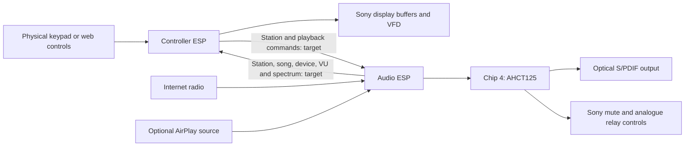

# Split-setup architecture

## Scope and current status

The target is two ESP32-S3 N16R8 development boards: a front-panel controller
and an audio receiver. The controller must also support portable interface
development without the Sony, keypad or audio ESP.

**Keep implemented behavior separate from the target architecture.**
Firmware 0.3.47 adds the browser-only travel front panel. The existing
controller still runs its original local radio decoder; audio playback has
not yet been migrated to the second ESP. The UART firmware currently provides
a diagnostic heartbeat and isolated GPIO mapping, not station commands or
audio telemetry. No complete inter-ESP exchange has yet been verified.

The first audio board repeatedly restarted, including with all header wires
removed. Device-specific ModemManager exclusions did not resolve it. Holding
BOOT during USB reconnection allowed verified ROM-loader access and flashing,
but changing UART backends and retaining panic output did not establish the
reset cause. Do not describe the board, PSRAM or UART wiring as proven faulty.
Its original full flash is backed up.

A replacement board was identified as ESP32-S3 revision 0.2 with 16 MiB flash
and 8 MiB PSRAM. Its complete factory flash was backed up before any writes.
The replacement's radio firmware installation and standalone playback
validation remain pending.

## Target division of responsibility

| Controller ESP | Audio ESP |
| --- | --- |
| Sony display scanning, brightness and display modes | Wi-Fi radio stream connection and MP3/AAC decoding |
| Physical keypad, presets and navigation | Optional AirPlay receiver |
| Front-panel web interface and travel simulator | Source arbitration between radio and AirPlay |
| Select a station and request playback over UART | Actual PCM playback and 48 kHz S/PDIF generation |
| Render received source/song information | Send station/song/source-device information |
| Render received VU and equalizer levels | Measure stereo VU and 11 frequency bands per channel |



The arrows marked **target** are not implemented audio-control messages in
the current diagnostic protocol. In the finished split setup, the controller
must not independently decode a second copy of the station stream.

## Audio board wiring

These are the user's explicit replacement-board assignments, not inferred
from analyser channel order.

| Audio GPIO | Chip 4 connection/function |
| --- | --- |
| 4 | Input 2: D.MUTE |
| 6 | Input 1: A.MUTE |
| 7 | Input 3: analogue relay |
| 15 | Input 4: optical S/PDIF data |
| 5 | Shared active-LOW `/OE` for all four AHCT125 gates |

The asserted levels of D.MUTE/A.MUTE and the relay-on level are **unverified**.
Keep `/OE` HIGH; do not automatically unmute or energize the relay based on
their names. All four outputs share `/OE`, including S/PDIF, so they must have
safe established values before that enable can go LOW.

Chip 1 is reserved for LRCK/BCK/DATA. Chip 2 is reserved for ATT/SHIFT/INIT/LATCH.
Their GPIOs and enables remain unspecified; this chapter does not authorize
driving them. Optical output does not by itself establish the Sony analogue
DAC's PCM format, initialization or attenuation interface.

The controller's separate display allocation remains AHCT v2:
GDATA2, GCLK1, CLEAR40, SDATA21, SCLK39 and shared STB38 to **both** TD chips.
See the [operating guide](13-screen-driver-operating-guide.md).

## Inter-ESP UART

Use 3.3 V UART directly between ESP GPIOs:

| Connection | Wiring |
| --- | --- |
| Controller TX43 | Audio RX44 |
| Audio TX43 | Controller RX44 |
| Ground | Common ESP ground |
| Serial format | 115200 baud, 8 data bits, no parity, 1 stop bit |

Do not level-shift this link to 5 V. GPIO19/20 are reserved for native USB.
GPIO35-37 are unavailable on the octal-PSRAM N16R8 module. Verify whether a
particular development board's USB-to-UART bridge also drives header RX44;
a pinout drawing does not prove bridge isolation. Crossed TX/RX and common
ground are necessary, not evidence of working communication.

### Implemented diagnostic protocol

The provisional UART1 service uses fixed 14-byte frames:

```text
A5 5A | version=1 | type | sequence:u32 LE | value:u32 LE | CRC16:u16 LE
```

CRC16-CCITT uses polynomial `0x1021`, initial value `0xffff`, over the first
12 bytes. Types are PING, PONG, MAP and ACK. The parser resynchronizes after
noise and rejects bad CRCs. Controller `/api/audio-link` reports sent frames,
matched replies, timeouts and bad frames.

MAP is an **isolated bench operation**, not an audio command: it briefly
enables chip 4, pulses one of GPIO4/6/7/15 six times, then disables it again.
Never use it with Sony-side audio wires connected. The controller's current
FIFO-polling transport is deliberately limited to sparse diagnostics;
continuous audio telemetry requires a properly buffered transport.

### Required next protocol layer

Station selection must carry the actual configured station URL/name rather
than assume both boards have matching preset lists. A selection generation
must accompany status updates so a late reply cannot overwrite a newer
preset or source selection. Define bounded payload lengths, framing/checksums,
acknowledgments and recovery before sending continuous telemetry.

The required audio-to-controller information is:

- Radio state: connecting, playing or failed; connected station ID/name and
  available stream/song metadata.
- AirPlay state: enabled/ready, connected and playing; title, artist and album.
- Source-device identity **when actually available**. Do not invent a phone
  name or equate a peer IP with a device name.
- Actual stereo VU RMS/peak/held levels, and 11 measured spectrum bands per
  channel. These are level data, not PCM samples.

Initially enabling AirPlay should announce `<<AirPlay>>`. Once a song is
playing, Now Playing shows song information. Station/Source mode shows the
radio station or available AirPlay device identity, falling back to AirPlay
when no device name was supplied.

Loss of the audio link must not leave stale meters presented as current
audio. Clear meters and expose disconnected/searching status. Keep transport,
metadata handling and FFT work out of the real-time display scan.

## Preset announcement

The physical controller behavior already verified on 0.3.44 is:

1. Show `Preset X`: `Preset` in physical cells 4-9, blank cell 10, number in
   cells 11-12.
2. Animate loading until the selected station connects.
3. Show the connected station ID for approximately two seconds.
4. Return to the selected display mode.

An unassigned preset briefly shows `Unassigned` without changing stations.
Preset selection never starts stopped physical display output. Retain these
rules when connection information moves to the audio ESP.

## Portable controller / travel demo

Open the controller radio page and select **Travel demo / virtual DAR-1000ES
front panel**, or go directly to:

```text
http://<controller-ip>/screen?demo=1#travel-demo
```

All scripts/fonts are served by the controller; no Internet connection,
audio board or Sony keypad is required. Use the controller's setup access
point if the usual Wi-Fi network is unavailable.

The simulator uses the existing bitmap encoder and all **22 physical 5x7
cells**: 770 independently rendered matrix pixels. Slot 22 is the leftmost
cell and slot 1 the rightmost; pixel bit numbering matches the
[bitmap catalogue](10-display-bitmap-catalogue.md). The front-panel button
groups follow the Sony reference photograph: left power/program/check,
Display Mode beside the glass, category block below left, central
memory/block keys, the 6-column numeric block, and right Direct/Link/Fine keys.
This is an interface simulator, not a voltage/current or flicker simulator.

Enable **browser-only travel demo** to operate its controls. Real hardware
controls are hidden in that mode. With demo disabled, the canvas is a
read-only preview of the controller's actual frame.

| Virtual control | Demo behavior |
| --- | --- |
| DISPLAY MODE | Cycle information/VU/equalizer modes and OFF |
| Hold DISPLAY MODE | Change DIM once while held; no extra short press |
| CHECK | Start Stereo VU only from OFF |
| Presets 1-16 | Preset label, dummy loading, station announcement, selected mode |
| MEMORY then number | Save the current dummy station to a browser-local preset |
| MHz/CLEAR | Cancel the pending demo notice/memory action |
| MONO MODE | Toggle the dummy mono state |
| Category/Music/Speech | Select/cycle dummy categories |
| UNDEFINED | Cycle dummy countries |
| BLOCK/FINE +/- | Browse synthetic stations, with large/single steps |
| LINK | Toggle dummy radio/AirPlay source |
| POWER/PROGRAM/DIRECT | Toggle their local demo state |

The **Dummy station / AirPlay metadata and preset assignments** section lets
you supply station, song, artist and optional device name. An empty AirPlay
song title displays `<<AirPlay>>`; Station/Source shows the supplied device
name. Clearing a dummy preset's name makes it unassigned.

VU/equalizer animation is synthetic and explicitly marked DEMO. The dummy
loading interval is fixed; it is not a real network connection. Country,
category, browse and memory interactions prototype the proposed interface,
not currently implemented physical-keypad radio-directory functionality.

**Virtual buttons send no POST requests, GPIO, UART or keypad commands.**
They do not tune real audio or change the real station/preset configuration.
Dummy preset assignments and the demo-mode preference are stored in browser
local storage for that controller origin, not in ESP NVS; another browser
or controller address has a separate copy.

## Safety and deployment

Before flash/reset/rewiring: stop physical display output, hold buffer enables
disabled, switch Sony OFF and disconnect the Sony-side signal wires. OFF
alone does not prevent backfeeding through enabled buffers. Initialize audio
`/OE` HIGH, and provide hardware reset/power-up protection: software GPIO5
initialization is not a boot-time power-good interlock.

An ESP can run from an appropriate regulated 5 V header supply, but the Sony
rail's spare current and the development board's power path still need
verification. Do not parallel ordinary USB VBUS and external Sony 5 V without
verified isolation/ORing. Never put 5 V on an ESP GPIO.

The 0.3.47 controller image is 3,140,416 bytes, leaving 5,312 bytes in its
3 MiB application slot. Its application slot and web filesystem were backed
up before installing the travel interface. NVS and OTA metadata are preserved.
The replacement audio factory backup is separate from the earlier audio
board's backup; do not restore one board's full flash blindly onto the other.
